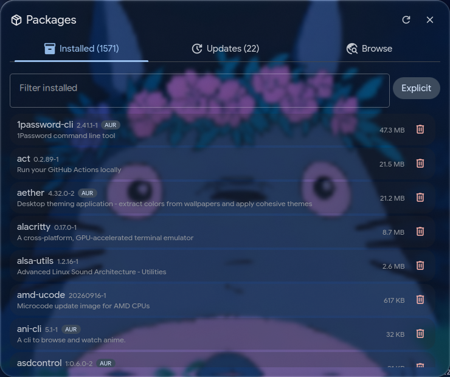

# Quickshell Package Manager

A pacman + AUR package manager panel for [end-4's illogical-impulse](https://github.com/end-4/dots-hyprland) Quickshell config on Arch Linux.



- **Installed**: every installed package with version, size and an AUR tag. Filter by name or description, switch between explicitly installed and all packages, remove a package (click the bin twice to confirm).
- **Updates**: pending repo and AUR updates. Arch doesn't support partial upgrades, so updates apply all at once.
- **Browse**: search the official repos and the AUR, then install with one click.

If your config ships `WindowGlass` (like [end4-pC](https://github.com/pctrade/end4-pC)), the panel gets the liquid glass backdrop. Otherwise it falls back to the theme's normal card.

## How changes are made

| Action | Runs |
| --- | --- |
| Install / remove / update repo packages | `pkexec pacman --noconfirm ...`, using the shell's own polkit prompt. Output streams into the panel. |
| Install / update AUR packages | `yay` in a `kitty` terminal, so you can review the PKGBUILD and enter your sudo password. |

`--noconfirm` takes pacman's default answer: replacements are accepted, and conflicts or broken dependencies abort the transaction. Removal uses `pacman -Rns`, which also removes unneeded dependencies and does not keep `.pacsave` backups of config files.

## Requirements

Arch Linux with an illogical-impulse Quickshell config, plus `yay`, `expac`, `pacman-contrib` (for `checkupdates`), `polkit`, `kitty` and `fish` (the last two ship with illogical-impulse).

```sh
sudo pacman -S --needed expac pacman-contrib
```

## Install

```sh
git clone https://github.com/uttam282005/quickshell-package-manager
cd quickshell-package-manager
./install.sh        # or ./install.sh <config-name> if your config isn't ~/.config/quickshell/ii
```

The script symlinks the module into your config (so `git pull` updates it), registers it in `GlobalStates.qml` and `IllogicalImpulseFamily.qml`, and installs a `Package Manager` desktop entry for your launcher. Quickshell reloads on its own.

## Keybind

Toggle the panel over IPC. In `hyprland.conf`:

```ini
bind = SUPER SHIFT, U, exec, qs -c ii ipc call packageManager toggle
```

Or, with the Lua config:

```lua
hl.bind("SUPER + SHIFT + U", hl.dsp.exec_cmd("qs -c $qsConfig ipc call packageManager toggle"), { description = "Package manager" })
```

## Uninstall

Remove `~/.config/quickshell/<config>/modules/ii/packageManager`, the `packageManagerOpen` line in `GlobalStates.qml`, the two `packageManager` lines in `IllogicalImpulseFamily.qml`, and `~/.local/share/applications/quickshell-package-manager.desktop`.

## License

MIT
